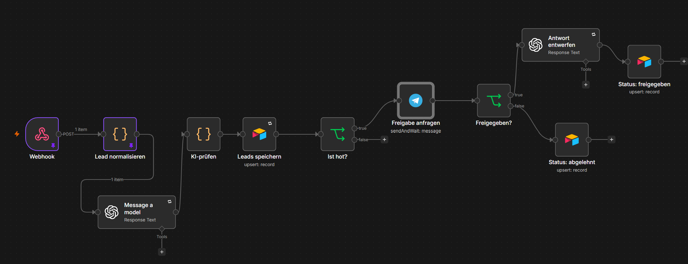
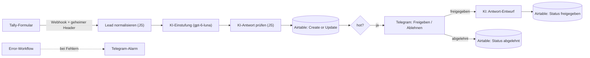

# Lead-Intake-Agent (n8n + KI)

Ein KI-Agent, gebaut mit n8n, der Anfragen aus einem Website-Formular normalisiert, beurteilt und in Kategorien einordnet. Leads werden strukturiert und mit Bewertung in Airtable übertragen. Bei vielversprechenden Anfragen werden die Daten über Telegram gesendet, mit den Optionen „Freigeben“ / „Ablehnen“. Nach einer Freigabe wird ein Antwort-Entwurf für den Kunden verfasst, gesendet wird er jedoch manuell.

<!-- Optional später: Link zum Loom-Video (2–3 Min.) -->

---

## Problem und Lösung

**Problem**

Formulare müssen von Hand sortiert, bewertet und die Leads händisch gespeichert werden. Die Kategorisierung kostet zusätzliche Zeit, und Spam muss aussortiert werden. Durch ständig neu eingehende Formulare kann es zu verspäteten Rückmeldungen und dadurch zum Verlust von Aufträgen kommen.
Schätzung: pro Anfrage ca. 5 Minuten (lesen, einschätzen, ins CRM übertragen). Bei 40 Anfragen pro Woche sind das über 3 Stunden.

**Lösung**

- Formular-Anfragen werden automatisch bereinigt und von einer KI als **hot / warm / cold / spam** eingestuft – mit Score und Begründung.
- Alle Leads landen in **Airtable** als CRM, ohne Duplikate.
- **Hot-Leads** gehen nicht automatisch raus: Ich bekomme eine Telegram-Nachricht mit **Freigeben / Ablehnen** (Human-in-the-Loop).
- Nach der Freigabe schreibt die KI einen **Antwort-Entwurf**, den ich prüfe und selbst versende.
- Fehler lösen einen **Telegram-Alarm** aus.

---

## Architektur

---

## Tech-Stack

- **n8n** (self-hosted, lokal getestet mit n8n 2.x)
- **OpenAI API** – Modell gpt-6-luna, Output als JSON
- **Airtable** als CRM
- **Tally** als Formular
- **Telegram-Bot** für Freigaben und Fehler-Alarme
- **JavaScript** in Code-Nodes (Normalisierung, Validierung, Test-Auswertung)

---

## Was im Code passiert

| Node | Aufgabe |
|---|---|
| Lead normalisieren | Sucht die Formularfelder nach ihrem **Titel** (nicht nach Position), übersetzt Tallys Auswahl-IDs in lesbaren Text, bereinigt E-Mail und Leerzeichen. |
| KI-prüfen | Prüft, ob die KI-Antwort gültiges JSON mit erlaubter Kategorie ist. Wenn nicht: Kategorie `manuell_pruefen` statt Absturz – kein Lead geht verloren. |
| Auswertung (Test-Workflow) | Vergleicht Soll- und Ist-Kategorie mit `filter` / `map` und berechnet die Trefferquote. |

---

## Fehlerbehandlung

| Fehlerfall | Verhalten |
|---|---|
| Anfrage ohne gültigen geheimen Header | n8n lehnt mit **403** ab (getestet) |
| KI liefert ungültiges JSON oder unbekannte Kategorie | Lead wird als `manuell_pruefen` gespeichert |
| OpenAI oder Airtable kurz nicht erreichbar (z. B. 429) | **Retry:** 3 Versuche, 5 Sekunden Pause |
| Fehler trotz Retry | **Error-Workflow** schickt per Telegram: Workflow, Node, Fehlermeldung, Link zur Ausführung |
| Formular doppelt abgeschickt | **Create or Update** anhand der E-Mail – kein doppelter Datensatz |
| Keine Reaktion auf die Freigabe | Wartezeit auf 24 Stunden begrenzt |

---

## Tests und Ergebnisse

- Eigener Test-Workflow mit **15 Test-Leads**, jeweils mit erwarteter Kategorie. Kein Airtable, keine Telegram-Nachrichten.
- Ergebnis: **15 von 15 richtig eingeordnet**, inklusive Grenzfällen (z. B. Coaching-Firma ohne Automatisierungsbezug → cold, Werbung → spam, Branche „Sonstige“ mit hohem Budget → warm).
- Einschränkung: Die Testfälle habe ich selbst formuliert. Echte Anfragen sind oft unschärfer.

---

## Kosten

- Im Schnitt ca. **210 Tokens pro Lead** (laut OpenAI-Dashboard).
- Bei gpt-6-luna (0,10 $ Input / 0,50 $ Output pro 1 Mio. Tokens) sind das **unter 0,01 Cent pro Lead** – 1.000 Leads kosten unter 10 Cent. Freigegebene Hot-Leads brauchen einen zweiten KI-Aufruf für den Antwort-Entwurf.
- Stand: Oktober 2026. Im Test lief alles über das kostenlose Kontingent.

---

## Setup

1. Die drei Dateien aus `workflows/` in n8n importieren.
2. Credentials anlegen:
   - **OpenAI API**
   - **Airtable Personal Access Token** – nur Scopes `data.records:read`, `data.records:write`, `schema.bases:read`, nur für diese eine Base
   - **Telegram API** (Bot über @BotFather)
   - **Header Auth** mit dem Header-Namen `X-Tally-Token` und einem langen Zufallswert
3. In Airtable eine Tabelle `Leads` anlegen mit: Name, E-Mail, Firma, Branche, Budget, Anliegen, Kategorie (Einfachauswahl: hot, warm, cold, spam, manuell_pruefen), Score, Begründung, Eingegangen, Status (Einfachauswahl: offen, freigegeben, abgelehnt), Antwortentwurf (langer Text).
4. In den Telegram-Nodes `DEINE_CHAT_ID` durch die eigene Chat-ID ersetzen.
5. Workflow **Fehler-Alarm** veröffentlichen und im Haupt-Workflow unter *Settings → Error Workflow* auswählen.
6. In Tally die Webhook-URL eintragen und den Header `X-Tally-Token` mit demselben Zufallswert hinzufügen.
7. Lokal testen: n8n über einen Tunnel erreichbar machen (z. B. Cloudflare Quick Tunnel) und n8n mit `WEBHOOK_URL` = Tunnel-Adresse starten, sonst funktionieren die Telegram-Buttons nicht.

---

## So habe ich mit KI gebaut

Ich habe vorher eine erste Automatisierung in Make.com gebaut und dieses Projekt genutzt, um n8n und JavaScript zu lernen. Dabei habe ich Claude als Lernbegleiterin eingesetzt:

- Konzepte erklärt bekommen (HTTP, Webhooks, n8n-Items)
- Code-Vorlagen Zeile für Zeile erklärt bekommen, abgetippt und verstanden, nicht blind kopiert
- Fehler gemeinsam gesucht: abgestürzter Tunnel, Tippfehler im Spaltennamen („Begrüßung“ statt „Begründung“), Node-Name mit Bindestrich („KI-prüfen“ statt „KI prüfen“), Rate Limits (wegen der kostenlosen OpenAI-Nutzung)
- Selbst getestet: jeden Schritt einzeln ausgeführt, Ergebnisse in Airtable kontrolliert, den 403-Test selbst gemacht
- Selbst entschieden: Freigabe statt automatischem Versand, neutrale Grußformel (statt Unterschrift mit meinem Namen), Modellwahl nach eigener Preisrecherche (Luna günstiger als nano)
- KI kritisch geprüft: Sie hat anfangs veraltete Modelle empfohlen und ein Datenrisiko beim Export erst spät erkannt. Deshalb habe ich die Exporte vor GitHub selbst durchsucht.
---

## Learnings und nächste Schritte

- Node-Namen müssen exakt übereinstimmen: Heißt die Node „KI-prüfen“, muss im Code $('KI-prüfen') stehen, nicht $('KI prüfen').
- Geringste Rechte: Jeder Zugang bekommt nur die Rechte, die er wirklich braucht. Mein Airtable-Token darf nur lesen und schreiben, und nur in der Base „Lead Intake“. Gerät er in falsche Hände, bleibt der Schaden klein.
- filter, map und Template Literals: filter sucht die Leads heraus, die eine Bedingung erfüllen, map macht aus jedem einen lesbaren Satz, Template Literals setzen Werte in Text ein.
- Getrennter Test-Workflow, damit keine 15 Fake-Leads im CRM landen und keine Freigabe-Nachrichten in Telegram ankommen.
- localhost ist zum Bauen, der Tunnel (in einem eigenen PowerShell-Fenster) für Zugriffe von außen. Nach jedem Tunnel-Start muss die neue Adresse in den Tally-Webhook eingetragen und als WEBHOOK_URL beim Start von n8n gesetzt werden.

**Nächste Schritte**

- Betrieb auf eigenem Server (Docker, HTTPS) statt Tunnel
- Webhook zusätzlich per HMAC-Signatur (`Tally-Signature`) prüfen
- KI-Antwort per JSON Schema absichern
- Mehr echte Anfragen testen und Prompt nachschärfen
